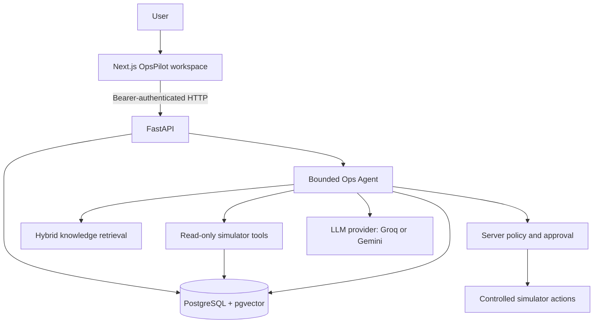

# OpsPilot

OpsPilot is a controlled operations workspace for investigating simulator incidents, reviewing human approvals, and reconstructing agent runs from stored events. The original task extraction workflow remains available as a separate task board.

## Features

- LLM task extraction with schema-validated JSON output (Groq by default, Gemini optional)
- Lightweight local RAG over example operational guidelines
- Pydantic validation of every extracted task before database writes
- PostgreSQL persistence through Docker Compose
- Seeded operational domain tables for services, incidents, deployments, logs, and metrics
- Kanban board with status updates and task deletion
- Clear API and UI handling for validation, database, and model-provider failures
- Docker Compose support for local runs
- Incident dashboard with simulator health evidence and live run status
- Persisted agent run timeline, human approval queue, and evaluation report
- JWT sign-in with viewer, operator, and admin roles

## Architecture



The model API key is read by FastAPI from the backend environment. The browser only calls FastAPI.

## RAG pipeline

Operational knowledge is stored under `knowledge/` and ingested into PostgreSQL + pgvector. Hybrid retrieval combines semantic and keyword matching and returns source citations with agent runs. The documents are examples for the simulator, not production policy.

## Operational domain

The PostgreSQL migration creates `services`, `incidents`, `deployments`, `logs`, and `metrics`. The latter four reference `services` with foreign keys. Seed data is included so the database can be inspected immediately after `docker compose up`.

The operations simulator adds deterministic services including `payments-api`, `checkout-api`, `auth-api`, `inventory-api`, and `notification-api`. Investigation evidence is available without any model through `GET /services/{id}/health`, `/metrics`, `/logs`, `/deployments`, and `/incidents`.

The deterministic Python tools in `backend/app/tools` expose the same evidence without FastAPI or a model. They validate typed inputs, bound result sizes, and return structured Pydantic results. Runbook search uses the hybrid knowledge retrieval.

`POST /agent/investigate` runs a bounded direct loop in which the configured model selects only registered read-only investigation tools, observes their results, and returns a diagnosis and possible proposal. Actual write actions remain outside this loop and run only through the approval service against the simulator. Each run and tool call is recorded in PostgreSQL.

Operational knowledge is stored under `knowledge/`. Docker Compose mounts it and the backend ingests it at startup (`KNOWLEDGE_DIR`); outside Compose run `PYTHONPATH=backend backend/.venv/bin/python -m app.rag.ingest --knowledge-dir knowledge`. PostgreSQL + pgvector stores the cleaned chunks and 128-dimensional embeddings. Retrieval returns provenance and is included as cited supporting context in agent diagnoses.

Knowledge search supports `semantic`, `keyword`, and `hybrid` modes. Hybrid is the default because the Phase 9 benchmark preserved the best top-3 result for both natural-language and exact operational identifiers.

Agent diagnoses include structured competing hypotheses with model-assigned scores and supporting or contradicting evidence. These scores are not calibrated probabilities. The agent persists hypothesis history and must gather additional evidence for ambiguous scenarios before finalizing a diagnosis.

Action types are separated into `READ` and `WRITE` tools. Write-capable operations such as incident updates, GitHub issues, reports, restarts, and rollbacks currently produce deterministic proposals only. Every proposal includes its target, reason, evidence, risk level, and `proposed` status; nothing is executed automatically.

Authentication uses JWT bearer tokens from `POST /auth/token`. Roles are `viewer`, `operator`, and `admin`. Policy is evaluated by the backend after the agent proposes an action, from the role, server-assigned risk, and the service environment: viewers cannot restart services, operators need approval for high-risk production actions, CRITICAL actions are never allowed in production, and the requester cannot approve their own action. The LLM cannot override the server-derived risk or policy outcome.

The append-only audit trail records login results, incident and run activity, tool calls, policy decisions, proposals, approval decisions, simulated execution, verification, and resolution. Authenticated users can retrieve a complete incident timeline with `GET /audit/incidents/{incident_id}`. Audit rows are protected from update, delete, and truncate by database triggers.

Agent dependencies have bounded timeouts for the model provider, retrieval, tools, and PostgreSQL connections/statements. Recognized transient timeouts, connection failures, deadlocks, serialization conflicts, and provider throttling/server errors receive at most one retry with a short backoff. Permanent tool failures become structured failed observations; incomplete evidence is surfaced as uncertainty, with actions withheld and escalation marked when required. Empty retrieval is reported as unavailable context, not proof that no relevant guidance exists.

See [the architecture overview](docs/architecture.md), [phase log](docs/PHASE-LOG.md), [build gates](docs/BUILD-GATES.md), and [Phase 15 interview notes](docs/interview-defense/phase-15.md) for implementation and verification details.

OpsBench v1 contains 100 versioned operational scenarios across incident investigation, ambiguity, missing evidence, injected tool and retrieval failures, unsafe requests, authorization, prompt injection, approval rejection, and verification failure. Validate and repeat-load the dataset with `PYTHONPATH=backend python -m app.benchmarks.opsbench --repeat 5`; see [`backend/benchmarks/opsbench/v1/scenarios.json`](backend/benchmarks/opsbench/v1/scenarios.json) and [the Phase 18 notes](docs/interview-defense/phase-18.md). This foundation validates scenario definitions and reproducibility; it does not claim model accuracy scores.

Phase 19 adds a paired prompt-only Gemini versus OpsPilot evaluator. Metric formulas and the initial measured slice are documented in [the Phase 19 notes](docs/interview-defense/phase-19.md); its JSON artifacts include raw predictions, per-case scores, latency, and model token usage.

Agent runs expose their actual persisted lifecycle through authenticated `GET /agent/runs` and `GET /agent/runs/{run_id}/events`. The ordered PostgreSQL trace includes model decisions, retrieval, tool calls, policy, approval, simulated execution, verification, and run status, with durations when measurable. Viewers can read only runs they initiated; operators and admins can inspect runs. See [Phase 22 notes](docs/interview-defense/phase-22.md).

The Phase 23 UI provides the incident-to-run-to-approval flow, displays only stored backend events, and reads the versioned evaluation artifact. It derives dashboard counts and run durations from API responses; model metrics absent from saved evaluation output are labeled as not measured. The legacy task workflow is available at `/tasks/new` and `/board`. Details and gates are in [Phase 23 notes](docs/interview-defense/phase-23.md).

The extraction contract is a JSON array of tasks with `task`, `owner`, `deadline`, and a `priority` enum. The model is asked for schema-validated JSON, then the complete response is validated with Pydantic before any PostgreSQL insert. Invalid responses are rejected; transient upstream failures are retried once and otherwise return a controlled 502/504.

## Tech stack

Python 3.11+, FastAPI, Pydantic, httpx (Groq OpenAI-compatible API, default model `openai/gpt-oss-120b`), optional Google GenAI SDK for Gemini, psycopg, PostgreSQL + pgvector, Next.js 14, TypeScript, Tailwind CSS, Docker, and pytest.

## Local setup

Requirements: Python 3.11+, Node.js 20+, npm, and Docker Compose. A Groq API key (or a Gemini key with `LLM_PROVIDER=gemini`) is needed for live agent investigations and task extraction; stored dashboard, incident, approval, and evaluation views use backend data.

Backend (from the repository root):

```bash
cd backend
python3.11 -m venv .venv
.venv/bin/python -m pip install -r requirements.txt
cp .env.example .env
# Set GROQ_API_KEY in backend/.env
.venv/bin/python -m uvicorn main:app --reload --host 127.0.0.1 --port 8000
```

Frontend, in another terminal from the repository root:

```bash
cd frontend
cp .env.local.example .env.local
npm ci
npm run dev
```

Open http://localhost:3000. The backend API is at http://localhost:8000 and its health check is http://localhost:8000/health.

## Docker Compose

```bash
cp backend/.env.example backend/.env
# Set GROQ_API_KEY in backend/.env
docker compose up --build
```

Open http://localhost:3000. API and health URLs are http://localhost:8000 and http://localhost:8000/health. PostgreSQL data is stored in the named `postgres_data` volume. Stop with `docker compose down`; the volume remains for the next start.

## Tests and checks

Run backend tests inside the backend container. They use a separate `opspilot_test` database on the same PostgreSQL server (created automatically) and never call a hosted model:

```bash
docker compose up -d --build
docker compose exec backend pytest -q tests
```

The RAG tests cover production outage, security exposure, deployment verification, irrelevant queries, source attribution, and prompt context wiring. For a live model check, set `GROQ_API_KEY` in `backend/.env` and start an investigation from an incident page.

Frontend type check and production build:

```bash
cd frontend
npx tsc --noEmit
npm run build
```

## API

| Method | Path | Behavior |
| --- | --- | --- |
| GET | `/health` | Returns API liveness status |
| POST | `/extract` | Validates text, extracts tasks, stores and returns them |
| GET | `/tasks` | Lists tasks, newest first |
| GET | `/incidents` | Lists simulator incidents and their service/environment |
| GET | `/agent/runs` | Lists up to 100 authorized stored runs and their trace events |
| GET | `/agent/runs/{run_id}/events` | Reads one authorized structured run trace |
| GET | `/approvals?decision=all` | Lists approval history; default lists pending approvals |
| GET | `/evaluation/latest` | Reads the checked-in machine-readable component study |
| PATCH | `/tasks/{id}` | Updates a task status (`todo`, `in_progress`, `done`) |
| DELETE | `/tasks/{id}` | Deletes a task |

`POST /extract` accepts `{"text":"..."}`. Empty or whitespace-only text and invalid update statuses receive HTTP 422. A missing task receives 404. Model-provider failures are returned as 502, or 504 on timeout. Unexpected persistence failures receive 500 without exposing stack traces.

## Design decisions

- **Validate model output:** schema-constrained generation improves shape consistency, and Pydantic validates the complete response before any task is inserted. This protects PostgreSQL from malformed or incomplete model output.
- **Use PostgreSQL:** one named-volume database supports the multi-entity direction without retaining a hidden second persistence system.
- **Keep the model provider on the backend:** the API key stays out of browser code and frontend configuration.
- **Prefer structured output:** JSON schema gives the model a specific task shape and priority enum instead of relying on arbitrary prose parsing.
- **Retry only transient failures:** timeouts, throttling, and 5xx responses get one retry (honoring `retry-after` for rate limits); malformed output is reported, not guessed.
- **Retrieval before inference:** guideline chunks are scored and included in the model prompt before structured generation; they are never read after the model call.

## Limitations

The simulator is local-only; no production infrastructure is connected. Agent success rate on the dashboard is a terminal run-status ratio and is not the labeled OpsBench task-success measure. Current component evaluation does not measure end-to-end diagnosis accuracy, tool selection accuracy, latency, or cost. Model output can be wrong and should be reviewed. The operational knowledge documents are illustrative.

## Project layout

```text
backend/
  main.py
  models.py
  database.py
  migrations/
  routes/tasks.py
  services/gemini.py
  services/task_service.py
  tests/
frontend/
  app/
  components/
  lib/api.ts
  types/task.ts
docker-compose.yml
```
