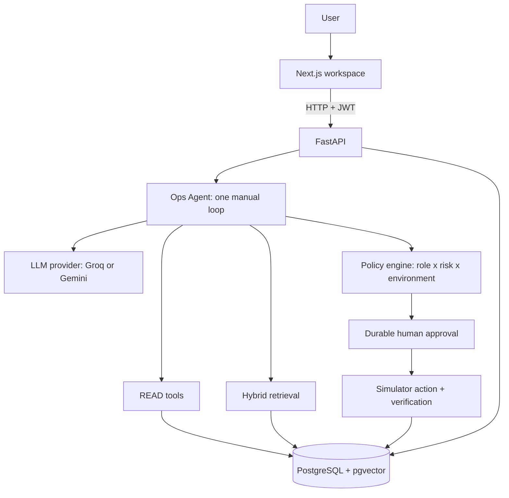

# OpsPilot

OpsPilot is a controlled AI operations assistant for a simulated production environment. For an incident, it:

1. investigates with deterministic tools;
2. retrieves runbooks and postmortems;
3. forms competing hypotheses and an evidence-backed diagnosis;
4. proposes a remediation;
5. lets server-side policy and a human reviewer decide whether that remediation runs;
6. executes it against the simulator;
7. verifies the result.

Every step is stored as audit records and an ordered event trace. A 100-scenario benchmark, OpsBench, measures the system.

It evolved, phase by phase, from [ops-assistant](https://github.com/Asadalk/ops-assistant), a task-extraction app. The original task workflow is still available at `/tasks/new` and `/board`.

> No real infrastructure is connected. Every write targets the local simulator.

## Architecture



The architecture has one frontend, one backend, one database, and one agent. The model can only choose a registered READ tool or return a diagnosis. The application runs the tool itself. Write actions never come from the model directly: they go through the policy engine, a human approval when required, simulator execution, and verification.

See [docs/architecture.md](docs/architecture.md) for the request flow, provider details, simulator faults, and reliability rules.

## What it does

| Area | Behavior |
| --- | --- |
| Simulator | Seeded services, incidents, deployments, logs, and metrics. Each degraded service has a hidden fault, and only the matching action fixes it. |
| Tools | `get_service_health`, `get_metrics`, `search_logs`, `get_recent_deployments`, `get_incident_history`, `search_runbooks`. All are typed and bounded, and none needs a model. |
| Retrieval | Markdown knowledge in `knowledge/`, ingested at startup into pgvector. Search is hybrid (semantic plus keyword), with a relevance floor and source citations. |
| Diagnosis | Competing hypotheses with model-assigned scores (not calibrated probabilities), supporting and contradicting evidence, and cited sources. |
| Policy | `viewer`, `operator`, and `admin` roles. Risk comes from the server, not the model. Production is stricter: operators need approval for HIGH risk, and CRITICAL is never allowed. |
| Approval | Pending approvals survive restarts, time out, and reject duplicate or unauthorized decisions. The requester cannot decide their own action. |
| Execution | Before and after snapshots. Verification returns `SUCCESS`, `FAILED`, or `INCONCLUSIVE`, with at most one automatic retry. Incidents are resolved only on `SUCCESS`. Actions are idempotent per run, action, and target. |
| Records | Append-only `audit_events` (the incident story) and `agent_events` (the run trace, including per-call token counts). |
| Reliability | Bounded timeouts. One retry for transient errors only, honoring `retry-after` on 429. Pacing keeps calls under the provider's tokens-per-minute limit. Failed tools or empty data become explicit uncertainty. |
| UI | Dashboard, incidents, run timeline, approvals, and evaluation. Every number comes from stored records. |

## Setup (Docker Compose)

```bash
cp backend/.env.example backend/.env
# Set GROQ_API_KEY in backend/.env (or LLM_PROVIDER=gemini plus GEMINI_API_KEY)
docker compose up --build
```

Open http://localhost:3000 and sign in as `operator`/`operator`. Other development accounts are `viewer`/`viewer` and `admin`/`admin`; change `AUTH_USERS_JSON` and `JWT_SECRET` outside local development.

Open an incident and choose **Start agent investigation**. A HIGH-risk production proposal pauses for approval; sign in as `admin` to approve it.

The API is at http://localhost:8000 (`/health`). PostgreSQL data persists in the `postgres_data` volume across `docker compose down` and `docker compose up`.

## Tests

```bash
docker compose exec backend pytest -q tests          # 100+ tests; separate opspilot_test database; no model calls
cd frontend && npx tsc --noEmit && npm run build      # type check and production build
```

The security suite (`backend/tests/security/`) covers:

- prompt injection through runbooks and logs;
- a viewer attempting a rollback;
- approval bypass, including self-approval;
- requests to reveal secrets.

## OpsBench

`backend/benchmarks/opsbench/v2/scenarios.json` contains 100 scenarios across 12 categories. Each scenario runs against its own fixture "world" in a dedicated `opspilot_bench` database. Its controls (tool or retrieval failure, hostile logs or runbooks, role, approval decision) are applied for real.

```bash
docker compose exec backend python -m app.benchmarks.opsbench          # validate the dataset and confirm a stable SHA
docker compose exec backend python -m app.benchmarks.runner run --agent opspilot --out /tmp/run
docker compose exec backend python -m app.benchmarks.runner report --out /tmp/run
```

The agents you can run are `rule` (deterministic reference), `opspilot` (LLM), and `baseline` (one prompt-only call whose proposal is executed directly). `--ablation` removes one component at a time. Metric definitions are in `backend/app/benchmarks/scoring.py`. Machine-readable run reports are in `backend/benchmarks/opsbench/v2/results/`.

## Project documents

- [docs/architecture.md](docs/architecture.md): the current architecture, request flow, simulator faults, and reliability rules.

## Limitations

- The simulator and knowledge documents are illustrative. The faults are designed so the right and wrong actions can be told apart.
- OpsBench labels were written by the developer. The rule-based agent was written for the same worlds, so its scores show that the harness is reproducible, not how good it is.
- Live model results depend on the provider, model version, and rate limits. Free-tier Groq allows 8,000 tokens per minute, so the live runs are slow.
- The dashboard success rate is a ratio of terminal run statuses, not OpsBench task success.
- Cost is not computed. Only provider-reported tokens are recorded.

## Project layout

```text
backend/app/
  agent/        agent loop, decision providers (Groq/Gemini), schemas, events
  tools/        READ tools and the tool base class
  rag/          ingestion, embeddings, hybrid retrieval
  policy/       role x risk x environment rules
  approval/     durable approvals and decisions
  db/           repositories, simulator actions and verification
  audit/        append-only audit events
  llm/          Groq HTTP client with token pacing
  benchmarks/   OpsBench loader, worlds, rule agent, runner, scoring, ablation
  api/routes/   FastAPI routers
backend/migrations/    ordered SQL migrations (001–016)
backend/benchmarks/    OpsBench datasets and result artifacts
knowledge/             runbooks, postmortems, architecture notes
frontend/app/          Next.js pages
docs/                  architecture documentation
```
